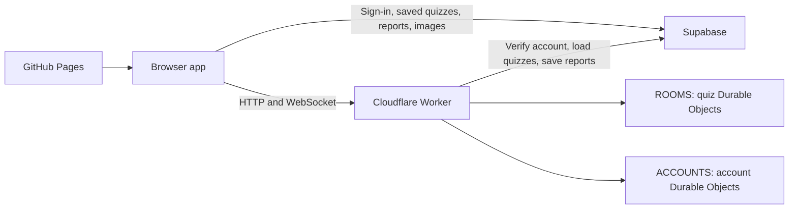

# Architecture

Gather is a browser app built with JavaScript modules and CSS. GitHub Pages serves the frontend. Supabase provides authentication, saved quizzes, saved reports and image storage. A Cloudflare Worker handles live rooms, WebSockets and account services.

## Source map

```text
public/
  index.html                 HTML shell
  app.js                     Stable browser entrypoint
  app/
    bootstrap.js             Connects feature controllers and starts the app
    router.js                Hash routes and page transitions
    state.js                 Current session, editor and live-room state
    ui.js                    Navigation, page shell, notices and dialogs
    events.js                Delegates events to feature handlers
    accessibility.js         Dialog focus and keyboard guards
    startup.js               Public settings, session restoration and startup
  core/                      DOM helpers, icons, question types and reordering
  services/
    api.js                   HTTP, Supabase database and backend requests
    session.js               Authentication requests and token refresh
  features/
    home/                    Landing page
    auth/                    Sign-in, sign-up, recovery and verification
    join/                    Quiz joining
    library/                 Saved quizzes, reports and open rooms
    editor/
      page.js                Separate quiz details, game settings and question editor
      model.js               Quiz defaults, validation and round assignments
      ai-prompt.js           Copyable AI instructions and importable format example
      import-export.js       Quiz JSON import/export and prompt copying
      actions.js, events.js, changes.js  Editor interactions and field updates
      data.js                Saved quiz loading, saving and uploads
    live/
      connection.js          WebSocket lifecycle, room checks and reconnect recovery
      session.js             Participant resume records and per-name storage
      clock.js               Monotonic clock and server-time calibration
      page.js                Lobby, question, result and unavailable-room screens
      answers.js, timer.js   Answer submission, feedback and countdown rendering
    results/
      page.js                Loads a live or saved detailed report
      index.js               Report state, navigation and event handling
      views/                 Overview, responses, participants, rounds, downloads
      data.js                Report analysis and answer formatting
      export.js              PDF, CSV, HTML and ZIP generation
      charts.js              Report charts
      styles.css             Detailed results styling
    learn/
      page.js                App route and account-sync bridge
      index.js               Learning state, practice flow and event handling
      views/                 Home, topics, cards, library, practice and other pages
      progress.js            Device progress and optional account sync
      map.js                 Interactive map controller
      styles.css, map.css    Learning and map styling
    chat/
      room-chat.js           Messages, announcements, unread counts and room settings
      mention-composer.js    Debounced participant picker and keyboard/touch input
      mentions.js            Draft ranges and recipient-specific mention rendering
      countdown.js           Announcement clock formatting and text updates
      events.js              Chat input and keyboard handling
      access.js              Account access applications and status
      styles.css             Mention list, message highlights and notification badge
    news/                    Live site announcement and dismissal
    legal/                   Policy text, page rendering and return links
    media/                   Encrypted room images and browser storage
  assets/images/             App logos
  fonts/                     Local fonts
  learn-data/                Geography data, flags and source attribution
  styles/                    Shared theme, components and responsive rules
    loading.css              Morphing activity indicator with reduced-motion support
  vendor/                    Third-party browser libraries and their licences
shared/
  quiz/engine.js             Quiz rules, scoring, rounds, validation and reports
  rooms/protocol.js          WebSocket message validation and limits
  http/api.js                Shared HTTP routes, auth and response handling
  media/room-media.js        Room image preparation and range responses
  chat/
    conversation.js          Room chat permissions, settings and message lifecycle
    mentions.js              Bounded member lookup and server-validated recipient ranges
    announcements.js         One persisted 1–60 minute announcement deadline
    access.js                Invitation redemption, catalog lookup and claim limits
  learn/progress.js          Progress validation and merge rules
  site/control.js           Announcement and access-request rules
worker/
  index.js                   Worker entrypoint and Durable Object exports
  http/                      Fetch handler and RPC error handling
  rooms/                     Quiz Durable Object and room adapter
  accounts/                  Account Durable Object
  config.js                  Retention and storage constants
scripts/                     Development server, build and release checks
run/main.py                  Local development launcher
wrangler.jsonc               Worker bindings, migrations and rate limits
.github/workflows/           GitHub Pages build and deployment
```

## How requests travel



The browser loads public service settings from `/api/config`. Public Supabase keys identify the app; user access tokens and database policies control access to account data. Server credentials belong in environment settings, never browser code.

Hosts save quizzes in Supabase, then ask the Worker to create a live room. Participants join with a room code. A room Durable Object owns the clock, answers, scores and reconnect state, and broadcasts snapshots over WebSockets. The browser renders those snapshots. Saving a report sends the selected report detail to Supabase. Account Durable Objects hold room indexes, learning progress and service state.

`worker/index.js` preserves the Durable Object class names used by the bindings and migrations. Moving implementation files does not create a new storage namespace.

## Changing a feature

Start in its `public/features/` folder. `page.js` renders or mounts the page; `actions.js`, `forms.js`, `events.js` and `changes.js` handle interactions where needed. Results and Learn keep individual screen templates in `views/`. Data processing and downloads have separate modules.

`app/bootstrap.js` creates one runtime per app instance. Feature factories receive shared state and explicit callbacks through that runtime. Action and form maps are registered by name; input, change and keyboard handlers run in order. Register a new controller here and add its route in `app/router.js` when necessary. Keep feature-specific behavior in the feature folder and reusable helpers in `core/` or `services/`.

Results and Learn view factories receive live getters into their controller's state. This keeps asynchronous navigation and account changes connected to the current instance without duplicating state or adding circular module imports.

Change quiz rules in `shared/quiz/engine.js`, shared HTTP behavior in `shared/http/api.js`, and Cloudflare transport or persistence in `worker/`. The development server uses the same shared rules and HTTP routes with a local room adapter.

## Editor and quiz files

Quiz details and Game settings are independent native disclosures. Their open states use the editor panel map, alongside question image and explanation disclosures. Expanding a section changes the view only; it does not change or reset quiz settings.

`editor/ai-prompt.js` describes the same import format used by `import-export.js`. The prompt uses the editor limits: 1–500 questions, 5–300 seconds per question, 2–8 choices and the supported point values. Imported question IDs and round assignments are remapped together. Chat options, including `chatMentions`, are preserved and validated. Live messages, announcements, participant data and results are not part of a quiz export.

## Joining and reconnecting

The WebSocket carries authentication, room snapshots, answers and conversation events. A failed handshake triggers a bounded HTTP availability check at `GET /api/rooms/:code`. This endpoint returns only availability, keeps origin and request limits, and does not expose room contents or participant data. Unknown and expired rooms return 404. Initial connection attempts stop with an actionable error; established rooms continue to recover from temporary outages.

Participant IDs and resume tokens stay in memory and, when allowed, per-room and per-name browser storage. Optional storage failures do not stop joining. Socket generations discard responses from older connections and prevent delayed token errors from redirecting a visitor who has left the room. A new connection clears stale latency samples and calibrates the monotonic display clock against server time.

Submitted answers are restored from the server's participant snapshot. A browser answer cache cannot mark a different participant as answered. Acknowledgements for an older question are ignored. Unconfirmed chat mutations are not replayed automatically, because the server may already have applied them. Drafts survive temporary outages, name lookups are refreshed, and conversation snapshots identify missed mentions.

## Chat and live announcements

Participant mentions are opt-in. Only the verified host can mention everyone. The server checks recipient IDs, message ranges and room permissions. Suggestions are bounded to 20 names per request and reuse the room socket without broadcasting a full roster or writing room state. The browser escapes message content and highlights only the tokens addressing the current participant.

An announcement countdown stores one server-generated end time. Existing browser timer updates render the clock locally; the deadline survives room restoration and reconnecting without per-second network messages or database writes. Countdown values are whole minutes from 1 to 60 and never start the quiz. Chat and announcements follow the room phase, and finished quizzes clear temporary conversation data.

Invitation codes are hashed before redemption. Persistent catalogs support additional codes alongside existing configured hashes, while one-use claims and attempt limits remain authoritative. Plaintext invitations are not stored in live room state or reports.

## Build and checks

- `npm run dev` starts the development server. `python3 run/main.py` is the local launcher.
- `npm run check` checks JavaScript syntax, relative module and asset references, and reconnect behavior.
- `npm run privacy` scans publishable source for private configuration and credentials.
- `npm run build` creates `dist/`, writes public browser configuration and versions nested assets for cache updates. Shared CSS imports are combined into one stylesheet.

`public/app.js` and `public/styles.css` remain stable entry URLs. `scripts/legacy-assets.json` maps relocated browser assets to compatibility files generated during the build, so older open tabs can still load them. New source imports use the feature paths.

The Pages workflow builds `dist/` and publishes it after a push to `main`. Worker deployment uses the bindings in `wrangler.jsonc`. Deploy backend changes before publishing frontend code that needs them. Keep existing authentication, origin validation, request limits and database access controls when extending either side.
