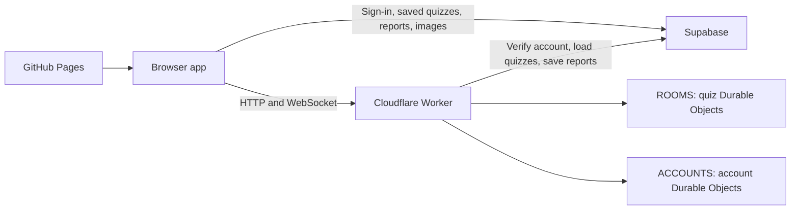

# Architecture

Gather is a TypeScript browser app with feature-level CSS. GitHub Pages serves the frontend. Supabase provides authentication, saved quizzes, saved reports and image storage. A Cloudflare Worker handles live rooms, WebSockets and account services.

## Source map

```text
src/
  client/                    Browser application and styles
    app.ts                   Stable browser entrypoint (emits app.js)
    app/
      bootstrap.ts           Registers feature controllers
      context.ts             Shared state and controller contracts
      router.ts              Hash routes, history and return navigation
      state.ts               Session, editor and live-room state
      ui.ts                  Page shell, notices and dialogs
      events.ts              Delegated browser events
      accessibility.ts       Focus and keyboard guards
      startup.ts             Public configuration and session restoration
    core/                    DOM helpers, icons, navigation, refresh, tags and usage
    services/                Auth, token refresh, Supabase and backend requests
    features/
      home/                  Home page
      auth/                  Sign-in, sign-up, recovery and verification
      join/                  Room-code entry and validation
      settings/              Account, usage, higher-limit requests, About and support
      library/               Tagged quizzes, hosted filters, reports and open rooms
      editor/
        page.ts              Quiz details, Game settings and question editor
        model.ts             Defaults, validation and rounds
        ai-prompt.ts         Copyable AI instructions and format example
        import-export.ts     Quiz JSON and prompt copying
        tags.ts              Tag editing and legacy collections
        data.ts              Saved quizzes and uploads
      live/
        connection.ts        WebSocket lifecycle and reconnect recovery
        session.ts           Per-room participant resume credentials
        clock.ts             Monotonic display clock and time calibration
        page.ts              Lobby, questions, results and unavailable rooms
        answers.ts           Answer submission and feedback
        timer.ts             Question countdown rendering
      results/
        page.ts              Lazy loading and live/saved reports
        index.ts             Report navigation and interactions
        views/               Overview, responses, participants, rounds, downloads
        data.ts              Analysis and answer formatting
        export.ts            PDF, CSV, HTML and ZIP generation
        charts.ts            Interactive report charts
      learn/
        index.ts             Learning state, practice and interactions
        views/               Individual learning screens
        progress.ts          Device progress and optional account sync
        map.ts               Interactive maps
        types.ts             Country and map contracts
      chat/
        room-chat.ts         Chat, announcements, unread counts and chat settings
        mention-composer.ts  Participant suggestions and keyboard/touch input
        mentions.ts          Recipient-specific mention rendering
        countdown.ts         Announcement countdown display
        access.ts            Account access requests and status cache
      news/                  Live site news and local dismissal
      legal/                 Terms, privacy and return navigation
      media/                 Image encryption, downloads and browser storage
    styles/                  Shared minimal theme, components and loading indicator
    browser.d.ts             Browser integration types
  shared/
    types.ts                 Quiz, participant, chat, learning and usage contracts
    account/                 Usage API, quotas, images, report saves and bulk deletion
    quiz/engine.ts           Authoritative rules, scoring, rounds and reports
    rooms/protocol.ts        WebSocket validation, authentication and limits
    http/api.ts              HTTP routes, auth and response handling
    media/room-media.ts      Room image preparation and range responses
    chat/                    Permissions, mentions, countdowns and access rules
    learn/progress.ts        Progress validation and merge rules
    site/control.ts          Site announcements and access-request rules
  server/
    index.ts                 Local HTTP/WebSocket server using the shared rules
    local-site.ts            Local announcement and access persistence
    local-usage.ts           Local allowance and hosting metadata
  worker/
    index.ts                 Worker entrypoint and Durable Object exports
    http/                    Fetch handler and RPC errors
    rooms/                   Quiz Durable Object and room adapter
    accounts/                Account Durable Object
    bindings.d.ts            Bindings generated from wrangler.jsonc
    env.ts                   Binding and secret types
    config.ts                Retention and storage constants
public/
  index.html                 HTML shell
  config.js                  Public runtime configuration placeholder
  assets/images/             App logos
  fonts/                     Local fonts
  learn-data/                Geography data, flags and credits
  vendor/                    Browser libraries and licences
scripts/                     Launch, compile, build, deployment and release checks
run/main.py                  Optional Python development launcher
package.json                 Dependencies and development commands
tsconfig*.json               Separate browser and service compiler environments
wrangler.jsonc               Worker bindings, migrations and request limits
.github/workflows/           GitHub Pages build and deployment
```

## How requests travel



The browser loads public service settings from `/api/config`. Public Supabase keys identify the app; user access tokens and database policies control access to account data. Server credentials belong in environment settings, never browser code.

Hosts save quizzes in Supabase, then ask the Worker to create a live room. Participants join with a room code. A room Durable Object owns the clock, answers, scores and reconnect state, and broadcasts snapshots over WebSockets. The browser renders those snapshots. Saving a report sends the selected report detail to Supabase. Account Durable Objects hold room indexes, learning progress and service state.

`src/worker/index.ts` preserves the Durable Object class names used by the bindings and migrations. Moving implementation files does not create a new storage namespace.

## Changing a feature

Start in its `src/client/features/` folder. `page.ts` renders or mounts the page; `actions.ts`, `forms.ts`, `events.ts` and `changes.ts` handle interactions where needed. Results and Learn keep individual screen templates in `views/`. Data processing and downloads have separate modules.

`src/client/app/bootstrap.ts` creates one runtime per app instance. Feature factories receive shared state and explicit callbacks through that runtime. Action and form maps are registered by name; input, change and keyboard handlers run in order. Register a new controller here and add its route in `src/client/app/router.ts` when necessary. Keep feature-specific behavior in the feature folder and reusable helpers in `core/` or `services/`.

Results and Learn view factories receive live getters into their controller's state. This keeps asynchronous navigation and account changes connected to the current instance without duplicating state or adding circular module imports.

Change quiz rules in `src/shared/quiz/engine.ts`, shared HTTP behavior in `src/shared/http/api.ts`, and Cloudflare transport or persistence in `src/worker/`. The development server uses the same shared rules and HTTP routes with a local room adapter.

## TypeScript and builds

The browser and services use separate TypeScript configurations so DOM and Cloudflare types stay in their own environments. `src/shared/types.ts` describes the data crossing feature and service boundaries; `src/client/app/context.ts` describes the registered controller callbacks. Existing JSON validation remains authoritative for untrusted input.

`npm run typecheck` checks both environments. `npm run check` also verifies emitted module and asset references and the reconnect/scoring smoke checks. `npm run privacy` checks publishable files for private configuration.

The development launcher loads the server through `tsx` and transforms requested browser modules with esbuild. Frontend edits appear on refresh; restart the server after service-code changes. `scripts/build.mjs` copies static assets, compiles the browser, combines shared CSS and versions module/asset URLs into `dist/`. Browsers receive JavaScript with the same public paths as before. Source TypeScript and service files are not website assets. Generated files should not be edited or committed.

Cloudflare compiles `src/worker/index.ts` directly. Its exported Durable Object class names, binding names and stored formats remain stable. Regenerate `src/worker/bindings.d.ts` with `wrangler types src/worker/bindings.d.ts --include-runtime false --strict-vars false --env-interface RuntimeBindings` after changing bindings.

## Editor and quiz files

Quiz details and Game settings are independent native disclosures. Their open states use the editor panel map, alongside question image and explanation disclosures. Expanding a section changes the view only; it does not change or reset quiz settings.

`editor/ai-prompt.ts` describes the same import format used by `import-export.ts`. The prompt uses the editor limits: 1–500 questions, 5–300 seconds per question, 2–8 choices and the supported point values. Imported question IDs and round assignments are remapped together. Chat options, including `chatMentions`, are preserved and validated. Live messages, announcements, participant data and results are not part of a quiz export.

## Joining and reconnecting

The WebSocket carries authentication, room snapshots, answers and conversation events. A failed handshake triggers a bounded HTTP availability check at `GET /api/rooms/:code`. This endpoint returns only availability, keeps origin and request limits, and does not expose room contents or participant data. Unknown and expired rooms return 404. Initial connection attempts stop with an actionable error; established rooms continue to recover from temporary outages.

Participant IDs and resume tokens stay in memory and, when allowed, per-room and per-name browser storage. Optional storage failures do not stop joining. Socket generations discard responses from older connections and prevent delayed token errors from redirecting a visitor who has left the room. A new connection clears stale latency samples and calibrates the monotonic display clock against server time.

Submitted answers are restored from the server's participant snapshot. A browser answer cache cannot mark a different participant as answered. Acknowledgements for an older question are ignored. Unconfirmed chat mutations are not replayed automatically, because the server may already have applied them. Drafts survive temporary outages, name lookups are refreshed, and conversation snapshots identify missed mentions.

## Chat and live announcements

Participant mentions are opt-in. Only the verified host can mention everyone. The server checks recipient IDs, message ranges and room permissions. Suggestions are bounded to 20 names per request and reuse the room socket without broadcasting a full roster or writing room state. The browser escapes message content and highlights only the tokens addressing the current participant.

An announcement countdown stores one server-generated end time. Existing browser timer updates render the clock locally; the deadline survives room restoration and reconnecting without per-second network messages or database writes. Countdown values are whole minutes from 1 to 60 and never start the quiz. Chat and announcements follow the room phase, and finished quizzes clear temporary conversation data.

Invitation codes are hashed before redemption. Persistent catalogs support additional codes alongside existing configured hashes, while one-use claims and attempt limits remain authoritative. Plaintext invitations are not stored in live room state or reports.

## Build and checks

- `npm run dev` starts the development server. `python3 run/main.py` is the local launcher.
- `npm run check` checks TypeScript, emitted module and asset references, and reconnect behavior.
- `npm run privacy` scans publishable source for private configuration and credentials.
- `npm run build` creates `dist/`, writes public browser configuration and versions nested assets for cache updates. Shared CSS imports are combined into one stylesheet.

`app.js` and `styles.css` remain stable public entry URLs. `scripts/legacy-assets.json` maps relocated browser assets to compatibility files generated during the build, so older open tabs can still load them. New source imports use the feature paths.

The Pages workflow builds `dist/` and publishes it after a push to `main`. Worker deployment uses the bindings in `wrangler.jsonc`. Deploy backend changes before publishing frontend code that needs them. Keep existing authentication, origin validation, request limits and database access controls when extending either side.

## Settings, usage and tags

`#settings` groups Account settings, Usage and About. The older `#account` link redirects to Account settings. Legal links preserve the return route, and About declares the app version and changelog in `features/settings/releases.ts`.

The browser and service share allowance validation in `src/client/core/usage.ts`. Default limits are 200 uploaded images, 100 saved quizzes, 200 detailed results and 500 participants per room. Summary results do not consume the detailed results allowance. The authenticated account API checks ownership and allowances; database counters and transactional triggers also protect direct database/storage writes. Existing over-limit content stays available. Higher-limit requests use the authenticated account identity, and approved participant allowances are captured when a room is created. Resume credentials keep reconnects in the same participant slot.

Bulk deletion requires a typed confirmation, scopes every operation to the authenticated owner, and uses bounded batches with a creation-time cutoff. Image removal uses the Storage API. Individual image deletion checks saved references and open rooms; deleting all images explicitly permits removing referenced files after rooms are closed. Saved-result lists request metadata in pages of 25, loading full answer data only when needed.

Tags live in `quiz.settings.tags`. The shared tag helper reads legacy collections as one tag, normalises duplicates and preserves tags through import/export. The library supports filtering and searching by tag. No table rename or destructive content migration is needed.

## Live tools and library controls

Room chat settings and announcements use the existing conversation controller and authenticated host commands. The host starts and advances the quiz manually; question countdowns, image readiness and scoring stay in `RoomEngine`. Restoring older room data ignores retired background and automation fields.

`src/client/features/library/controls.ts` renders the search, filter menu and quiz-tool footer. `filters.ts` owns filtering, clear actions, outside clicks and keyboard closing. Shared page headings in `src/client/core/navigation.ts` keep the back control aligned with the title. Settings includes a plain external link to Gather’s Buy Me a Coffee page, without third-party scripts or embedded widgets.

Hosting metadata preserves quiz creation/edit dates and supports hosted filters. Settings remember their entry route, chat access uses an owner-scoped in-memory cache, and older changelog entries render in small pages. Higher-usage applications carry a role and explanation; approved allowances, service availability and account messages come from authenticated service data. Honeypot checks supplement the existing verification, origin checks, request bounds, rate limits and access policies.
